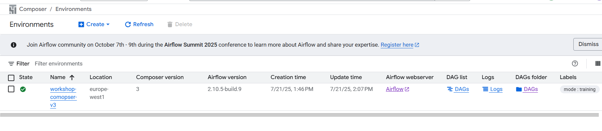
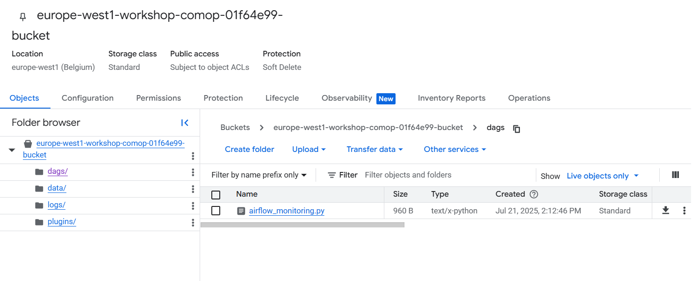

# Chapter 03 — Cloud Composer Environment Setup via CLI

## Overview

In this chapter, we provision a secure, private-IP **Google Cloud Composer** environment from scratch using the `gcloud` CLI. Rather than using the overly permissive default Compute Engine service account or default VPC network, we configure a dedicated custom Service Account, least-privilege IAM roles, and an isolated custom VPC subnetwork.

### What We Are Going to Do
1. **Enable Required Google Cloud APIs**: Activate Composer, Dataproc, BigQuery, Cloud Storage, Compute Engine, GKE, Cloud SQL, IAM, Logging, and Monitoring APIs.
2. **Create a Custom Service Account & Bind IAM Roles**:
   * Create the worker Service Account (`example-workshop-composer-sa`) that executes your Airflow tasks and Dataproc jobs.
   * Grant the `roles/composer.ServiceAgentV2Ext` extension role to Google's managed **Cloud Composer Service Agent** (`service-<PROJECT_NUMBER>@cloudcomposer-accounts.iam.gserviceaccount.com`).
3. **Provision Custom VPC Networking & Cloud Storage Buckets**:
   * Create a custom-mode VPC (`composer-workshop-vpc`) and subnetwork (`composer-workshop-subnet`) with Private Google Access (`--enable-private-ip-google-access`) and secondary CIDR ranges.
   * Create an internal ingress firewall rule (`allow-internal-dataproc-traffic`) so Spark executors on Dataproc Serverless can communicate over internal IPs.
   * Create the dedicated DAGs bucket and Dataproc staging bucket.
4. **Create the Cloud Composer Environment**: Provision `workshop-composer-v3` (`composer-3-airflow-2.10.5`) attached to our custom VPC, subnetwork, and Service Account.
5. **Teardown & Cost Cleanup**: Delete the Composer environment when finished to avoid ongoing hourly compute charges.

---

## Chapter Contents

| File | Description |
| :--- | :--- |
| [`03_environment_setup_cli.ipynb`](./03_environment_setup_cli.ipynb) | Interactive step-by-step guide explaining every IAM role, VPC CIDR check, firewall rule, and Composer creation flag. |
| [`scripts/01_enable_apis_and_iam.sh`](./scripts/01_enable_apis_and_iam.sh) | Enables required GCP APIs, creates the custom Service Account, and binds worker + Composer Service Agent IAM roles. |
| [`scripts/02_setup_vpc_and_buckets.sh`](./scripts/02_setup_vpc_and_buckets.sh) | Creates the custom VPC, Subnetwork with secondary IP ranges, internal firewall rule, and GCS buckets. |
| [`scripts/03_create_composer_env.sh`](./scripts/03_create_composer_env.sh) | Runs `gcloud composer environments create` using your `.env` configuration. |
| [`scripts/04_cleanup_composer_env.sh`](./scripts/04_cleanup_composer_env.sh) | Deletes the Cloud Composer environment to stop billing when the workshop is complete. |

---

## How to Run the Scripts

Make sure you have configured your root [`.env`](../.env) file (`cp .env.example .env`), then run each script in order from the repository root:

```bash
# Step 1: Enable APIs and configure Service Accounts + IAM roles
bash 03_environment_setup_cli/scripts/01_enable_apis_and_iam.sh

# Step 2: Create Custom VPC, Subnetwork, Firewall rule, and GCS buckets
bash 03_environment_setup_cli/scripts/02_setup_vpc_and_buckets.sh

# Step 3: Create the Cloud Composer environment (takes ~15-25 minutes)
bash 03_environment_setup_cli/scripts/03_create_composer_env.sh

# Step 4 (After completing the workshop): Delete the Composer environment
bash 03_environment_setup_cli/scripts/04_cleanup_composer_env.sh
```

---

## UI Verification Screenshots

Once `03_create_composer_env.sh` finishes, your environment will appear in the Google Cloud Console:



Click the **DAGs** link in the environment list to open the associated Cloud Storage `/dags` folder:


