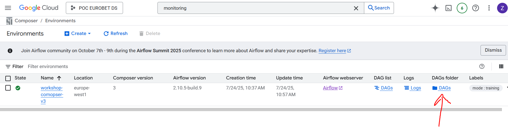
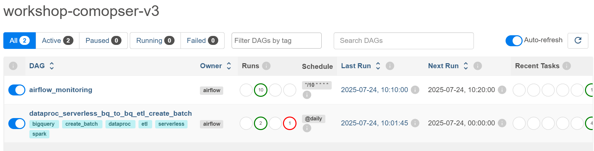
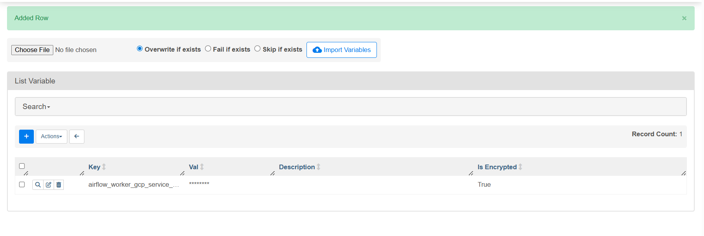
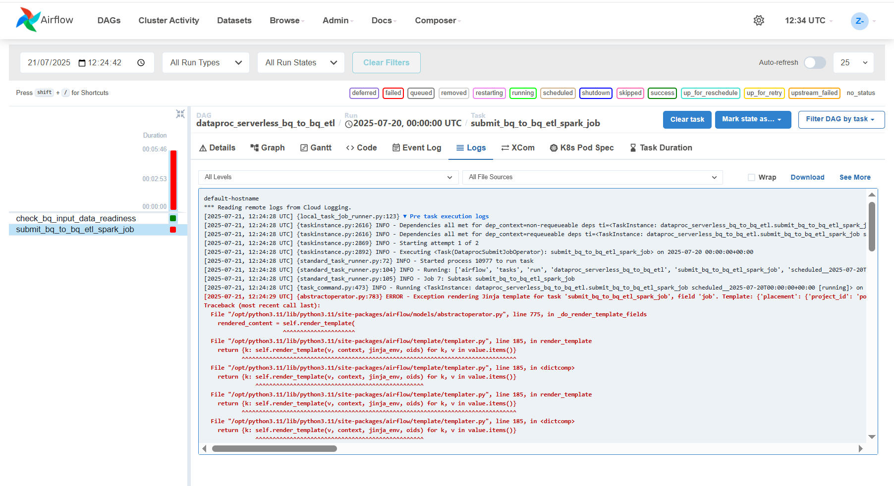
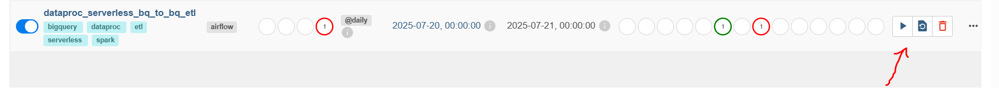

# Chapter 04 — Orchestrating Dataproc Serverless & BigQuery ETL

## Overview

In this chapter, we build, deploy, and trigger an end-to-end **BigQuery + Dataproc Serverless PySpark ETL pipeline** orchestrated by **Google Cloud Composer**.

> **Google Cloud Console Naming Note**: In the Google Cloud Console and BigQuery Studio, **Dataproc** and **Dataproc Serverless** now appear under **Managed Apache Spark** / **Google Cloud Serverless for Apache Spark** (with **Batches** for serverless runs and **Clusters** for Compute Engine clusters). The underlying API (`dataproc.googleapis.com`), `gcloud dataproc` CLI, and Airflow operators (`DataprocCreateBatchOperator`) retain the `dataproc` naming.

### What We Are Going to Do
1. **Seed the Upstream BigQuery Table (`sales_data`)**: Create the `example_composer_workshop` dataset and populate `sales_data` with sample transactions partitioned by `transaction_date` and clustered by `product_id`.
2. **Understand the PySpark Application ([`spark_apps/bq_etl_job.py`](./spark_apps/bq_etl_job.py))**:
   * Reads `sales_data` from BigQuery using the built-in Dataproc Serverless Spark BigQuery connector.
   * Filters transactions for the target `--processing-date` and aggregates `SUM(amount) AS total_sales` per `product_id`.
   * Writes the aggregated rows to `filtered_sales` in BigQuery.
3. **Understand the Airflow DAG ([`dags/bq_etl_dag.py`](./dags/bq_etl_dag.py))**:
   * Ensures the destination dataset (`BigQueryCreateEmptyDatasetOperator`) and table (`BigQueryCreateTableOperator`) exist before running Spark.
   * Submits the PySpark batch job to **Dataproc Serverless** via `DataprocCreateBatchOperator` in **deferrable mode** (`deferrable=True`), using dynamic runtime Jinja macros (`{{ ds_nodash }}`, `{{ ts_nodash | lower }}`).
4. **Deploy, Configure Variables & Trigger the Pipeline**:
   * Upload `bq_etl_job.py` to `gs://<composer-bucket>/spark_apps/` and `bq_etl_dag.py` to `gs://<composer-bucket>/dags/`.
   * Configure the `airflow_worker_gcp_service_account` and `SUBNET_NAME` Airflow Variables.
   * Trigger a DAG run and inspect the task logs in the Airflow Web UI.

---

## Chapter Contents

| File | Description |
| :--- | :--- |
| [`04_dataproc_serverless_etl.ipynb`](./04_dataproc_serverless_etl.ipynb) | Interactive notebook walking through DAG deployment, Airflow Variable configuration, triggering runs, and debugging task logs. |
| [`dags/bq_etl_dag.py`](./dags/bq_etl_dag.py) | Airflow DAG orchestrating BigQuery DDL setup and `DataprocCreateBatchOperator` submission. |
| [`spark_apps/bq_etl_job.py`](./spark_apps/bq_etl_job.py) | PySpark batch job reading and writing BigQuery tables on Dataproc Serverless. |
| [`sql/seed_sales_data.sql`](./sql/seed_sales_data.sql) | BigQuery DDL/DML script creating and seeding `example_composer_workshop.sales_data`. |
| [`scripts/01_seed_bigquery_data.sh`](./scripts/01_seed_bigquery_data.sh) | Executes `sql/seed_sales_data.sql` against your GCP project and verifies the loaded rows. |
| [`scripts/02_deploy_and_trigger_dag.sh`](./scripts/02_deploy_and_trigger_dag.sh) | Uploads `bq_etl_job.py` and `bq_etl_dag.py` to GCS, sets Airflow Variables, and triggers the DAG. |

---

## How to Run the Scripts

From the repository root (after configuring [`.env`](../.env)):

```bash
# Step 1: Seed the upstream BigQuery dataset and sales_data table
bash 04_dataproc_serverless_etl/scripts/01_seed_bigquery_data.sh

# Step 2: Upload the PySpark job & DAG to GCS, set Airflow Variables, and trigger the DAG
bash 04_dataproc_serverless_etl/scripts/02_deploy_and_trigger_dag.sh
```

---

## Airflow UI Walkthrough Screenshots

### 1. Locating the Composer DAGs Bucket


### 2. Unpausing and Triggering the DAG in the Airflow Web UI



### 3. Inspecting Task Logs & Retriggering Runs


