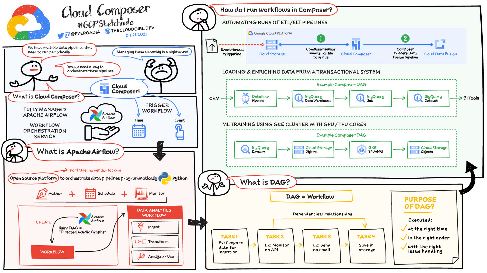
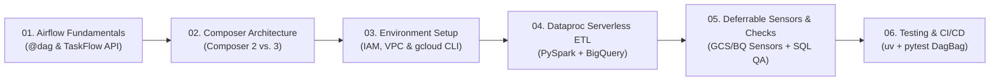
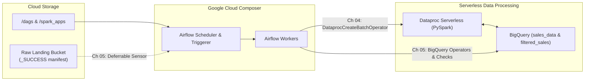

# Google Cloud Composer & Apache Airflow Workshop

> **Part 2 of 3 in the Google Cloud Data Engineering Series**
> * **Part 1 — Compute Layer:** [`dataproc-workshop`](https://github.com/EilinLux/dataproc-workshop) *(Developing PySpark ETL jobs & `utils.py` on Dataproc Clusters and Dataproc Serverless)*
> * **Part 2 — Orchestration Layer (This Repo):** [`composer-workshop`](https://github.com/EilinLux/composer-workshop) *(Scheduling, Deferrable Sensors, BigQuery Quality Gates & Local `DagBag` Testing with Cloud Composer 3)*
> * **Part 3 — Production CI/CD Blueprint:** [`CiCdAirFlowDagTemplate`](https://github.com/EilinLux/CiCdAirFlowDagTemplate) *(Automated Cloud Build CI/CD pipelines for testing & syncing DAGs + `utils.zip` to Cloud Composer)*

---

## What is Google Cloud Composer?

As data platforms grow beyond a handful of scripts, scheduling jobs with `cron` or isolated cloud functions quickly breaks down. Pipelines need to wait on upstream file arrivals, coordinate multi-step transformations across multiple gcp products (such as **Cloud Storage**, **BigQuery**, and **Apache Spark**), retry transient failures with exponential backoff, and provide a single pane of glass for lineage and alerting.

A good solution for this need, Apache AirFlow + Cloud Composer. 

On one hand, **Apache Airflow** is the industry-standard open-source platform for programmatically authoring, scheduling, and monitoring workflows as **Directed Acyclic Graphs (DAGs)** in Python.

On the other, **Google Cloud Composer** is Google Cloud's fully managed workflow orchestration service built on Apache Airflow. Instead of self-hosting and patching Airflow schedulers, metadata databases, message brokers, and worker clusters, Cloud Composer provisions and manages the entire stack for you:
* **Zero-Ops Infrastructure**: Google manages the underlying compute (GKE Autopilot in Composer 2, or fully abstracted tenant infrastructure in **Composer 3**), the **Cloud SQL** metadata database, and the asynchronous **Airflow Triggerer** and **DAG Processor** services.
* **GitOps-Friendly DAG Sync**: Dropping a Python file into your environment's **Cloud Storage** `/dags` folder automatically synchronizes it across all schedulers and workers.
* **Deep GCP Integration**: Native, pre-installed operators and deferrable sensors for **BigQuery**, **Dataproc Serverless**, **Dataflow**, **Vertex AI**, and **Cloud Storage**, secured via Google Cloud **IAM** and **Private IP VPC networking**.
* **Unified Observability**: Every task log, scheduler heartbeat, and worker metric streams directly into **Cloud Logging** and **Cloud Monitoring**.


*Source and rights reserved to TheCloudGirl.Dev*

---

## The Workshop Storyline: From First DAG to Production Data Platform

This workshop is designed as a continuous, six-chapter engineering journey. You will step into the role of a Data & Platform Engineer building a **Daily Retail Sales Analytics Platform** on Google Cloud—starting from core Airflow concepts and progressing all the way to serverless PySpark orchestration, event-driven sensors, and automated CI/CD testing:



### Act I — Mastering the Engine ([`01_airflow_fundamentals/`](./01_airflow_fundamentals/README.md))
Before provisioning cloud infrastructure, you learn how Apache Airflow thinks. In [`01_airflow_fundamentals/`](./01_airflow_fundamentals/README.md), you explore the lifecycle of a DAG from file parsing to task execution, wire task dependencies (`>>`, `chain`), configure resilient retries, and modernize legacy boilerplate into clean, functional Python pipelines using the **`@dag` and `@task` TaskFlow API** ([`taskflow_basics_dag.py`](./01_airflow_fundamentals/dags/taskflow_basics_dag.py)).

### Act II — Looking Under the Hood of Cloud Composer ([`02_cloud_composer_architecture/`](./02_cloud_composer_architecture/README.md))
Once you understand Airflow, [`02_cloud_composer_architecture/`](./02_cloud_composer_architecture/README.md) reveals how Google Cloud wraps Airflow into a managed enterprise service. You examine how the Composer GCS bucket, Cloud SQL database, Web Server, Schedulers, and Workers interact—and why **Cloud Composer 3** eliminates the complex GKE secondary IP range management required in **Cloud Composer 2**.

### Act III — Building the Secure Cloud Foundation ([`03_environment_setup_cli/`](./03_environment_setup_cli/README.md))
With the architecture clear, you put on the Platform Engineer hat in [`03_environment_setup_cli/`](./03_environment_setup_cli/README.md). Instead of relying on overly permissive default service accounts or public networks, you use automated `.sh` scripts and `gcloud` CLI commands to:
1. Enable the required GCP APIs and create a **least-privilege custom Service Account** (`roles/composer.worker`, `roles/composer.ServiceAgentV2Ext`).
2. Provision a **custom VPC network and subnetwork** with Private Google Access and internal firewall rules for Spark communication.
3. Launch your private-IP **Cloud Composer 3** environment (and learn how to tear it down cleanly when finished to avoid ongoing billing).

### Act IV — Orchestrating Heavy Compute with Dataproc Serverless (*Managed Apache Spark*) & BigQuery ([`04_dataproc_serverless_etl/`](./04_dataproc_serverless_etl/README.md))
Now that your Composer environment is running, it is time to process real data in [`04_dataproc_serverless_etl/`](./04_dataproc_serverless_etl/README.md). You seed an upstream **BigQuery** table (`sales_data`) with retail transactions ([`01_seed_bigquery_data.sh`](./04_dataproc_serverless_etl/scripts/01_seed_bigquery_data.sh)) and deploy a multi-step ETL pipeline ([`bq_etl_dag.py`](./04_dataproc_serverless_etl/dags/bq_etl_dag.py)) that:
1. Idempotently creates the target BigQuery dataset and table (`BigQueryCreateEmptyDatasetOperator` & `BigQueryCreateTableOperator`).
2. Submits a **PySpark** batch job ([`bq_etl_job.py`](./04_dataproc_serverless_etl/spark_apps/bq_etl_job.py)) to **Dataproc Serverless** (*now labeled **Managed Apache Spark / Google Cloud Serverless for Apache Spark** in the Google Cloud Console*) via `DataprocCreateBatchOperator` to aggregate daily revenue per product and write the results back to BigQuery (`filtered_sales`).
3. Teaches you how to manage **Airflow Variables** (`var.value.*`) and debug task failures in the Airflow Web UI.

### Act V — Making the Pipeline Event-Driven & Self-Validating ([`05_deferrable_sensors_and_bigquery/`](./05_deferrable_sensors_and_bigquery/README.md))
In production, upstream data rarely lands at an exact clock tick—and holding onto an Airflow worker slot while polling for files wastes compute. In [`05_deferrable_sensors_and_bigquery/`](./05_deferrable_sensors_and_bigquery/README.md), you upgrade the pipeline ([`sensor_bq_etl_dag.py`](./05_deferrable_sensors_and_bigquery/dags/sensor_bq_etl_dag.py)) with production patterns:
1. **Deferrable Sensors (`deferrable=True`)**: `GCSObjectExistenceSensor` and `BigQueryTableExistenceSensor` wait asynchronously on the **Airflow Triggerer** for upstream `_SUCCESS` markers without consuming worker slots.
2. **BigQuery SQL Pushdown & Quality Gates**: `BigQueryInsertJobOperator` executes partitioned SQL transformations directly inside BigQuery, followed by `BigQueryCheckOperator` to assert that the output partition is never empty.

### Act VI — Bulletproofing with Local Unit Tests & CI/CD ([`06_testing_and_cicd/`](./06_testing_and_cicd/README.md))
Finally, because a single syntax error or deprecated import in your `/dags` bucket can halt production scheduling, [`06_testing_and_cicd/`](./06_testing_and_cicd/README.md) closes the loop with automated quality gates. Using **`uv`** and **`pytest`** ([`test_dag_integrity.py`](./06_testing_and_cicd/tests/test_dag_integrity.py)), you load every DAG across Chapters `01`, `04`, and `05` into Airflow's `DagBag` locally to verify zero import errors, zero dependency cycles (`check_cycle`), and mandatory retry/tag governance before Cloud Build syncs changes to Cloud Composer.

---

## End-to-End Pipeline Architecture



---

## Repository Structure (Organized by Chapter `01`–`06`)

Each chapter is a self-contained folder with its own **`README.md`**, interactive **`.ipynb` notebook**, heavily commented **reference code** (`dags/`, `spark_apps/`, `sql/`, `tests/`), and executable **`.sh` scripts** (`scripts/`). All architecture diagrams and UI screenshots live in [`artifacts/`](./artifacts/):

```text
composer-workshop/
├── .env.example                                      # Documented template with example GCP, Composer & Airflow variables
├── .env                                              # Local environment variables (loaded by all scripts & DAGs)
├── pyproject.toml                                    # Python dependencies managed with uv
├── README.md                                         # Main workshop storyline, index & quick-start guide
├── artifacts/                                        # Architecture diagrams & UI screenshots referenced in notebooks/READMEs
│   ├── 01_airflow_architecture.png
│   ├── 01_airflow_dag_concepts.png
│   ├── 01_airflow_ui_gantt_view.png
│   ├── 01_airflow_ui_graph_view.png
│   ├── 01_airflow_ui_grid_view.png
│   ├── 02_composer_architecture.png
│   ├── 03_composer_dags_folder.png
│   ├── 03_composer_env_created.png
│   ├── 04_airflow_ui_retrigger_dag.png
│   ├── 04_airflow_ui_task_logs.png
│   ├── 04_airflow_ui_trigger_dag.png
│   ├── 04_airflow_ui_unpause_dag.png
│   └── 04_composer_dags_bucket_link.png
│
├── 01_airflow_fundamentals/                          # Chapter 01: Core Apache Airflow & TaskFlow API
│   ├── README.md
│   ├── 01_airflow_fundamentals.ipynb
│   └── dags/
│       └── taskflow_basics_dag.py
│
├── 02_cloud_composer_architecture/                   # Chapter 02: Cloud Composer Managed Architecture (v2 vs. v3)
│   ├── README.md
│   └── 02_cloud_composer_architecture.ipynb
│
├── 03_environment_setup_cli/                         # Chapter 03: Provisioning Composer (APIs, IAM, VPC, CLI & Teardown)
│   ├── README.md
│   ├── 03_environment_setup_cli.ipynb
│   └── scripts/
│       ├── 01_enable_apis_and_iam.sh
│       ├── 02_setup_vpc_and_buckets.sh
│       ├── 03_create_composer_env.sh
│       └── 04_cleanup_composer_env.sh
│
├── 04_dataproc_serverless_etl/                       # Chapter 04: Dataproc Serverless PySpark & BigQuery ETL
│   ├── README.md
│   ├── 04_dataproc_serverless_etl.ipynb
│   ├── dags/
│   │   └── bq_etl_dag.py
│   ├── spark_apps/
│   │   └── bq_etl_job.py
│   ├── sql/
│   │   └── seed_sales_data.sql
│   └── scripts/
│       ├── 01_seed_bigquery_data.sh
│       └── 02_deploy_and_trigger_dag.sh
│
├── 05_deferrable_sensors_and_bigquery/               # Chapter 05: Deferrable Sensors & BigQuery Native Checks
│   ├── README.md
│   ├── 05_deferrable_sensors_and_bigquery.ipynb
│   ├── dags/
│   │   └── sensor_bq_etl_dag.py
│   └── scripts/
│       └── 01_deploy_sensor_dag.sh
│
└── 06_testing_and_cicd/                              # Chapter 06: Local DAG Integrity Testing (uv + pytest) & CI/CD
    ├── README.md
    ├── 06_testing_and_cicd.ipynb
    ├── tests/
    │   └── test_dag_integrity.py
    └── scripts/
        └── 01_run_dag_tests.sh
```

---

## Chapter-by-Chapter Reference Table

| Chapter | Folder & Guide | Notebook | Scripts & Code |
| :--- | :--- | :--- | :--- |
| **01** | [`01_airflow_fundamentals/`](./01_airflow_fundamentals/README.md) | [`01_airflow_fundamentals.ipynb`](./01_airflow_fundamentals/01_airflow_fundamentals.ipynb) | [`dags/taskflow_basics_dag.py`](./01_airflow_fundamentals/dags/taskflow_basics_dag.py) |
| **02** | [`02_cloud_composer_architecture/`](./02_cloud_composer_architecture/README.md) | [`02_cloud_composer_architecture.ipynb`](./02_cloud_composer_architecture/02_cloud_composer_architecture.ipynb) | — |
| **03** | [`03_environment_setup_cli/`](./03_environment_setup_cli/README.md) | [`03_environment_setup_cli.ipynb`](./03_environment_setup_cli/03_environment_setup_cli.ipynb) | [`01_enable_apis_and_iam.sh`](./03_environment_setup_cli/scripts/01_enable_apis_and_iam.sh), [`02_setup_vpc_and_buckets.sh`](./03_environment_setup_cli/scripts/02_setup_vpc_and_buckets.sh), [`03_create_composer_env.sh`](./03_environment_setup_cli/scripts/03_create_composer_env.sh), [`04_cleanup_composer_env.sh`](./03_environment_setup_cli/scripts/04_cleanup_composer_env.sh) |
| **04** | [`04_dataproc_serverless_etl/`](./04_dataproc_serverless_etl/README.md) | [`04_dataproc_serverless_etl.ipynb`](./04_dataproc_serverless_etl/04_dataproc_serverless_etl.ipynb) | [`dags/bq_etl_dag.py`](./04_dataproc_serverless_etl/dags/bq_etl_dag.py), [`spark_apps/bq_etl_job.py`](./04_dataproc_serverless_etl/spark_apps/bq_etl_job.py), [`01_seed_bigquery_data.sh`](./04_dataproc_serverless_etl/scripts/01_seed_bigquery_data.sh), [`02_deploy_and_trigger_dag.sh`](./04_dataproc_serverless_etl/scripts/02_deploy_and_trigger_dag.sh) |
| **05** | [`05_deferrable_sensors_and_bigquery/`](./05_deferrable_sensors_and_bigquery/README.md) | [`05_deferrable_sensors_and_bigquery.ipynb`](./05_deferrable_sensors_and_bigquery/05_deferrable_sensors_and_bigquery.ipynb) | [`dags/sensor_bq_etl_dag.py`](./05_deferrable_sensors_and_bigquery/dags/sensor_bq_etl_dag.py), [`01_deploy_sensor_dag.sh`](./05_deferrable_sensors_and_bigquery/scripts/01_deploy_sensor_dag.sh) |
| **06** | [`06_testing_and_cicd/`](./06_testing_and_cicd/README.md) | [`06_testing_and_cicd.ipynb`](./06_testing_and_cicd/06_testing_and_cicd.ipynb) | [`tests/test_dag_integrity.py`](./06_testing_and_cicd/tests/test_dag_integrity.py), [`01_run_dag_tests.sh`](./06_testing_and_cicd/scripts/01_run_dag_tests.sh) |

---

## Local Environment Setup (`uv` & Jupyter Kernel)

This repository uses **[`uv`](https://docs.astral.sh/uv/)** (`pyproject.toml`) to manage `apache-airflow`, `apache-airflow-providers-google`, `pyspark`, `python-dotenv`, `pytest`, and `ipykernel` inside an isolated `.venv` virtual environment.

### 1. Install `uv` (if not already installed)
```bash
# macOS / Linux
curl -LsSf https://astral.sh/uv/install.sh | sh
# or via Homebrew:
brew install uv
```

### 2. Create or Synchronize the Virtual Environment (`uv sync`)
```bash
# Synchronize .venv from pyproject.toml (installs Airflow, GCP providers, PySpark, pytest, ipykernel)
uv sync

# (Optional) If initializing a new project from scratch with uv:
# uv init --python 3.12
# uv add "apache-airflow>=2.10.0,<3.0.0" "apache-airflow-providers-google>=10.22.0" pyspark python-dotenv
# uv add --dev pytest ruff ipykernel
```

### 3. Register & Select the Jupyter Kernel (Prevents `ModuleNotFoundError: No module named 'airflow'` or `'pyspark'`)
If you open any `.ipynb` notebook locally in VS Code / Cursor / Antigravity / JupyterLab and see `ModuleNotFoundError`, your notebook is attached to the global system Python instead of `.venv`. Register and select the `uv` kernel:
```bash
# Register the .venv as a named Jupyter kernel
uv run python -m ipykernel install --user --name composer-workshop --display-name "Python (composer-workshop)"
```
Then click the **Kernel selector** in the top-right corner of the notebook editor and choose **`Python (composer-workshop)`** (or `.venv/bin/python`).

---

## End-to-End Quick Start (Google Cloud CLI & Scripts)

```bash
# 0. Authenticate with Google Cloud, set ADC quota project, and configure .env
gcloud auth login
gcloud auth application-default login
PROJECT_ID=$(gcloud config get-value project)
gcloud config set project "$PROJECT_ID"
gcloud config set billing/quota_project "$PROJECT_ID"
gcloud auth application-default set-quota-project "$PROJECT_ID"
cp .env.example .env
# Edit .env with your GCP_PROJECT_ID (e.g., gai-community29oct-7500)

# Chapter 03: Provision GCP APIs, IAM, VPC/Subnets, Buckets & Cloud Composer
bash 03_environment_setup_cli/scripts/01_enable_apis_and_iam.sh
bash 03_environment_setup_cli/scripts/02_setup_vpc_and_buckets.sh
bash 03_environment_setup_cli/scripts/03_create_composer_env.sh

# Chapter 04: Seed BigQuery and deploy & trigger the Dataproc Serverless ETL DAG
bash 04_dataproc_serverless_etl/scripts/01_seed_bigquery_data.sh
bash 04_dataproc_serverless_etl/scripts/02_deploy_and_trigger_dag.sh

# Chapter 05: Deploy the Deferrable Sensors & BigQuery Quality Check DAG
bash 05_deferrable_sensors_and_bigquery/scripts/01_deploy_sensor_dag.sh

# Chapter 06: Run Local DAG Integrity Tests with uv + pytest
bash 06_testing_and_cicd/scripts/01_run_dag_tests.sh

# Cleanup: Delete the Cloud Composer environment when done to avoid charges
bash 03_environment_setup_cli/scripts/04_cleanup_composer_env.sh
```
